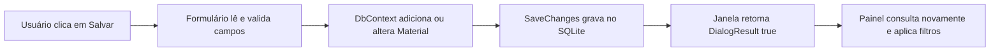

# Entendendo o AulaFlow

## O que dizer ao gestor

“O AulaFlow é um projeto de estudo em C# para organizar arquivos usados em videoaulas. Usei WPF para a interface e SQLite para manter o catálogo local. Além do cadastro completo, implementei busca, filtro, relatório CSV e uma automação que copia arquivos para pastas por curso e disciplina sem substituir o original. Usei assistência de IA para revisar e evoluir o projeto e estou estudando as decisões e os testes. Não há edição de vídeo nem integração com os sistemas da empresa nesta versão.”

Adapte àquilo que você consegue demonstrar. Ser capaz de seguir o fluxo no código é mais útil que decorar nomes de padrões.

## Tecnologias, uma por vez

**C#** é a linguagem: classes, métodos, condições e tratamento de erros. **.NET** fornece o runtime e bibliotecas. **WPF** é a tecnologia de interface para Windows. **XAML** descreve controles e layout; o arquivo `.xaml.cs` trata os eventos desses controles. **SQLite** é o banco relacional armazenado em arquivo. **Entity Framework Core** é o ORM que mapeia objetos C# para registros SQL.

`Material` é uma classe. Cada objeto representa um cadastro. `Id` identifica o registro, `Nome` descreve o conteúdo e `CaminhoArquivo` guarda apenas sua localização. O conteúdo do vídeo não entra no banco. Por isso mover o arquivo fora da aplicação pode quebrar a referência; o usuário deve editar o caminho.

## Caminho de uma ação

No cadastro, `Trim()` remove espaços das bordas. O programa exige os campos e a existência do arquivo. `MaterialTools.Validar` também verifica se tipo e status pertencem às opções aceitas. Na edição, `Find(id)` busca a entidade pelo identificador; as propriedades mudam e `SaveChanges()` grava o UPDATE. Na exclusão, há confirmação e `Remove` seguido de `SaveChanges`; isso remove somente a linha do banco.

O `DbContext` representa uma unidade de trabalho com o banco. `using var` o descarta ao terminar o escopo. `DbSet<Material>` representa a coleção de materiais persistidos. `AsNoTracking()` evita rastreamento na consulta somente de leitura; `OrderByDescending` e `ThenByDescending` ordenam por data e ID. `ToList()` executa a consulta. O EF gera o SQL; não há concatenação de entradas do usuário em SQL.

Na inicialização, `App.OnStartup` cria o banco e as tabelas se ainda não existem. A pasta fica no perfil local do usuário, fora do código e da pasta do executável. Um construtor com opções permite que os testes usem outro banco sem tocar nos dados reais.

## Busca e interface

`ItemsSource` conecta a lista de objetos à tabela. Cada coluna usa um binding como `{Binding Nome}` para ler uma propriedade de `Material`. Quando texto ou status mudam, um evento chama `AplicarFiltros` e troca a lista exibida. A busca ignora diferenças entre maiúsculas e minúsculas; não remove acentos. O filtro combina texto e status com AND. Não há `ObservableCollection` porque a tela recarrega e substitui a lista após cada alteração.

O layout usa Grid para as colunas, StackPanel para conteúdo vertical, WrapPanel para ações e ScrollViewer para permitir rolagem. A barra lateral identifica o único módulo existente; não há menus falsos para recursos futuros.

## Automação de arquivos

`CopiarOrganizadoAsync` valida o material, adapta caracteres inválidos nos nomes de pastas e cria uma estrutura por curso e disciplina. O prefixo `Aula_` evita nomes reservados do Windows. O ID no nome ajuda a diferenciar materiais. `FileMode.CreateNew` falha se o destino já existe. O arquivo de origem é aberto apenas para leitura.

`await CopyToAsync` aguarda a cópia sem bloquear a interface durante a transferência. O botão fica desabilitado até terminar e é reativado em `finally`, inclusive em caso de erro. `async void` é usado no evento WPF; a regra retorna `Task<string>`, que pode ser aguardada e testada. Se a transferência falhar, o serviço tenta remover sua cópia parcial. Não há cancelamento nem garantia de recuperação após queda do processo ou falta de energia.

Essa ação organiza arquivos; não altera codecs, duração ou conteúdo do vídeo. Não muda o status automaticamente, pois copiar um arquivo não significa que a edição foi concluída.

## Exportação e erros

O CSV usa ponto e vírgula, envolve campos em aspas e duplica aspas internas. Valores que podem ser interpretados como fórmulas recebem um apóstrofo. UTF-8 com BOM ajuda a preservar acentos em leitores de planilha. A exportação usa a lista filtrada e omite caminhos locais dos arquivos.

`try/catch` transforma falhas de banco, abertura ou cópia em mensagens. Isso não elimina a causa: arquivo ausente exige corrigir o caminho; falta de acesso exige verificar a pasta. A versão atual mostra detalhes da exceção para diagnóstico e não possui arquivo de logs.

## Arquitetura e escolhas

É uma aplicação pequena com interface em code-behind, modelo, contexto de dados e funções extraídas para um serviço. **Não é MVVM completo**, não usa injeção de dependências e não tem API. A decisão foi manter um protótipo compreensível. O próximo passo com o crescimento seria extrair operações de persistência para serviços, introduzir ViewModels e comandos, fazer consultas assíncronas e adotar migrações. Não é necessário afirmar que esses passos já foram feitos.

SQLite simplifica instalar e demonstrar uma ferramenta local. Para vários usuários e sincronização, seria necessário avaliar um servidor de banco, API, autenticação, conflitos e permissões. Não basta colocar o arquivo SQLite em uma pasta compartilhada.

## Testes e exercícios para explicar sem decorar

Os testes automatizados exercitam busca combinada, escape do CSV, validação, cópia segura e persistência com SQLite em memória. Cada teste usa dados próprios; não edita o banco real. Eles não substituem testar a janela, acessibilidade ou arquivos grandes.

1. Abra `Material.cs` e explique cada propriedade com um cadastro de exemplo.
2. Siga `SalvarMaterial_Click` até `SaveChanges`. Explique o que muda entre criar e editar.
3. Mude a busca para também considerar status e execute os testes. Depois decida se faz sentido manter a alteração.
4. Explique por que a exclusão não remove o vídeo e por que a cópia não sobrescreve arquivos.
5. Mostre onde o banco é criado e por que `AsNoTracking` está apenas na listagem.
6. Explique a diferença entre `await` e criar uma thread: aqui a intenção é aguardar I/O sem travar a tela.

## Perguntas prováveis

**Por que WPF?** A demanda da vaga envolve desktop em C# e .NET, e WPF permite construir uma interface Windows com XAML e bindings.

**Por que EF Core?** Para mapear a entidade e operar o banco por objetos e LINQ. Continuo precisando entender tabelas, chaves, SQL e o custo das consultas.

**O que você melhoraria?** Paginação e filtros no banco, serviços para CRUD, MVVM, migrações, logs, testes de interface e cancelamento de cópias. Priorizaria conforme volume de dados e necessidade da operação.

**Como integraria uma API?** Definiria contrato e autenticação com a equipe, usaria HttpClient e DTOs, trataria timeout e erros e testaria com ambiente de homologação. Isso é uma proposta futura, não um recurso atual.

**Como investigaria um bug?** Reproduziria o cenário, verificaria mensagem e dados, isolaria a causa, corrigiria, adicionaria teste quando útil e repetiria o fluxo na interface.

**Você fez tudo sozinho?** Explique a colaboração com IA com transparência e demonstre as partes que estudou, testou e consegue modificar. Não afirme domínio de funcionalidades que ainda não consegue explicar.
